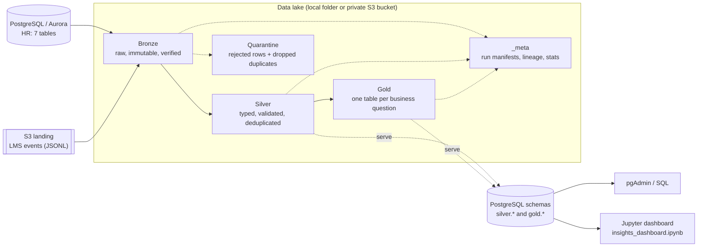

# Coding Workshop - Data Engineering: Performance & Talent Analytics

> [Main Guide](../docs/README.md) | [Validation Guide](../docs/validation.md) | [Data Engineer Guide](../docs/data-engineer.md)

A batch ETL pipeline and medallion data lake (Bronze → Silver → Gold) that combines ACME's HR system (PostgreSQL) with the learning management system (LMS event files on S3) to answer workforce performance, skills, succession and attrition questions.

* [1. Business Questions](#1-business-questions)
* [2. Architecture](#2-architecture)
* [3. Where the Code Lives](#3-where-the-code-lives)
* [4. How to Run](#4-how-to-run)
* [5. Configuration](#5-configuration)
* [6. Data Lake Layout](#6-data-lake-layout)
* [7. Bronze Layer](#7-bronze-layer)
* [8. Silver Layer: Contracts and Data Quality](#8-silver-layer-contracts-and-data-quality)
* [9. Gold Layer: Data Products](#9-gold-layer-data-products)
* [10. Source-to-Target Mapping](#10-source-to-target-mapping)
* [11. Lineage and Observability](#11-lineage-and-observability)
* [12. Error Handling](#12-error-handling)
* [13. Testing and Evidence](#13-testing-and-evidence)
* [14. Cloud Deployment (EKS)](#14-cloud-deployment-eks)
* [15. Assumptions, Trade-offs and Limitations](#15-assumptions-trade-offs-and-limitations)

## 1. Business Questions

| # | Question | Gold table | Answer on the sample data |
|---|----------|------------|---------------------------|
| Q1 | What are the performance ratings and review history for each employee? | `employee_performance_history` | 4,000 reviews (2 periods × 2,000 employees) with previous rating and change |
| Q2 | Which employees have critical skill gaps in key competencies? | `employee_skill_gaps` | 325 critical gaps (required − proficiency ≥ 2); 993 assessments below the required level |
| Q3 | Who are the high-potential employees ready for promotion? | `promotion_candidates` | 357 High potential + Ready Now; 132 recommended (latest rating ≥ 4 and no critical gap) |
| Q4 | What training and development activities has each employee completed? | `employee_learning_summary` | 29,574 clean events across 42 courses; per-employee counts, completion rate, quiz average |
| Q5 | Which employees are at risk of attrition based on performance trends? | `attrition_risk` | 230 with declining ratings, 142 of them also rated High risk by HR; computed risk band High 169 / Medium 406 / Low 1,425 |
| Q6 | How does employee performance correlate with team and project outcomes? | `team_performance_outcomes`, `team_outcome_correlation` | Team average rating vs on-time project % r = 0.54; vs outcome score r = 0.24 (27 teams with projects) |
| Q7 | What is the distribution of skills across the organization? | `skill_distribution` | Proficiency counts per competency × department, with average gap and % below required |

## 2. Architecture



The job runs three stages in order, plus an optional serving step. Each can also run on its own (`--stage bronze|silver|gold|serve`):

1. **Bronze** (`ingest_into_bronze`): copies the source data unchanged, adds ingestion metadata, and verifies every write.
2. **Silver** (`transform_to_silver`): applies the schema contracts, casts types, removes duplicates and flags anomalies. Rejected rows go to quarantine.
3. **Gold** (`aggregate_to_gold`): joins the Silver tables into business-grain tables, then runs the reconciliation checks.
4. **Serve** (`publish_to_postgres`, optional): copies the Silver, Gold and quarantine tables into the PostgreSQL schemas `silver`, `gold` and `quarantine`, so they can be queried with SQL (pgAdmin, BI tools, the insights notebook). It runs only when all reconciliation checks pass. On its own (`--stage serve`) it first confirms that the latest run that built Gold passed every check. The lake stays the system of record, and the source tables in `public` are never written to.

The same code runs locally and on EKS. `IS_LOCAL` and the other environment variables select the database (local PostgreSQL or Aurora with SSL) and the lake (local folder or S3).

## 3. Where the Code Lives

The workshop rules allow no new files, so the pipeline lives in the existing example job.

| File | Purpose |
|------|---------|
| `data/_examples/python-job/job.py` | Entry point: parses `--stage` / `--self-test` / `--seed-source`, runs the stages, writes the run manifest |
| `data/_examples/python-job/settings.py` | Constants, attrition-risk weights and the Silver schema contracts (`SILVER_CONTRACTS`) |
| `data/_examples/python-job/common.py` | `PipelineError`, JSON logging, `Config` from environment variables, retry with backoff, AWS error hints |
| `data/_examples/python-job/storage.py` | `LocalStore` / `S3Store` and the Parquet / JSON table helpers |
| `data/_examples/python-job/run_context.py` | Per-run counts, lineage and checks; the `timed_stage` decorator (duration, records/min, peak memory) |
| `data/_examples/python-job/bronze.py` | PostgreSQL extract, `--seed-source`, immutable HR snapshots, verified incremental LMS copy |
| `data/_examples/python-job/silver.py` | `validate()`, quarantine, dedup, HR and LMS transforms |
| `data/_examples/python-job/gold.py` | The 8 Gold tables and the 28 reconciliation checks |
| `data/_examples/python-job/insights_dashboard.ipynb` | Jupyter dashboard for stakeholders: data-trust checks, KPI dashboard, Q1–Q7 with charts and findings, interactive explorer, recommendations |
| `data/_examples/python-job/serve.py` | Publishes Silver, Gold and quarantine to the PostgreSQL schemas `silver` / `gold` / `quarantine` in one transaction, verifying row counts |
| `data/_examples/python-job/self_tests.py` | The 23 built-in tests (`python3 job.py --self-test`) |
| `data/_examples/python-job/requirements.txt` | pandas, numpy, pyarrow, psycopg, boto3 (+ numexpr/bottleneck pinned for the EKS image) |
| `infra/s3.tf` | Private lake bucket `coding-workshop-lake-<id>` with all public access blocked |
| `infra/locals.tf` | Registers the job as `talent-etl`, and builds its environment (Aurora, bucket, region) |
| `infra/eks.tf` | Uploads the sample data to the landing zone, gives the node role S3 access to the lake bucket only, and deploys the job with Helm |
| `infra/rds.tf` | Adds Aurora to the EKS cluster security group, so the job's pods can reach it |
| `infra/helm/templates/python-job.yaml`, `infra/helm/values.yaml` | Kubernetes Secret for the job settings, optional job arguments, optional `hostNetwork` |

The job is split into one module per responsibility, all in the same folder (no new folders). Imports only point "down" (`settings` → `common` → `storage` → `run_context` → `bronze`/`silver`/`gold` → `job`), so there are no circular imports. On EKS every `*.py` in the folder is shipped to the pod: `infra/eks.tf` passes each module to Helm as `pythonJob.modules.<name>`, and the ConfigMap mounts them next to `job.py` in `/app`. Shared logic is reused rather than copied. One `validate()` function enforces every table's contract, and one storage interface (`LocalStore` / `S3Store`) serves every layer.

## 4. How to Run

### Local

```sh
# 1. Start local services and load the HR source (once)
source ~/.bashrc && ./bin/start-dev.sh
cd sampleData/data-engineering-sample-performance-scenario/data-engineering-performance-talent-management
IS_LOCAL=true POSTGRES_NAME=postgres POSTGRES_USER=postgres POSTGRES_PASS=postgres123 ./load.sh
cd -

# 2. Install dependencies and run the pipeline
pip install -r data/_examples/python-job/requirements.txt
cd data/_examples/python-job
IS_LOCAL=true POSTGRES_PASS=postgres123 python3 job.py 2>&1 | tee /tmp/talent-etl.log

# 3. Run one stage only
IS_LOCAL=true POSTGRES_PASS=postgres123 python3 job.py --stage gold

# 4. Run the built-in tests (add POSTGRES_PASS / SELF_TEST_S3_URI for integration tests)
python3 job.py --self-test
```

The local lake is written to `~/talent-etl-lake` (override with `LAKE_ROOT`).

### Cloud (EKS)

```sh
echo "export TF_VAR_aws_eks_enabled=true" >> ~/.bashrc
source ~/.bashrc
./bin/deploy-backend.sh
kubectl logs -f job/coding-workshop-talent-etl
```

`deploy-backend.sh` creates the EKS cluster and the lake bucket, uploads the sample data to `s3://coding-workshop-lake-<id>/landing/`, and runs `python /app/job.py --seed-source`. The `--seed-source` flag loads the HR CSVs into Aurora on the first run only, because Aurora is reachable only from inside the VPC. The Kubernetes Job deletes itself 100 seconds after finishing, but the run manifest stays in S3.

> [!WARNING]
> Keep `TF_VAR_aws_eks_enabled=true` set for every later deploy. Without it, Terraform destroys the EKS cluster **and the lake bucket, including its data**.

## 5. Configuration

All settings come from environment variables. Nothing is hardcoded.

| Variable | Local default | Cloud | Purpose |
|----------|---------------|-------|---------|
| `IS_LOCAL` | `true` | `false` | Local vs cloud. In cloud mode, PostgreSQL uses `sslmode=require` |
| `POSTGRES_HOST` / `POSTGRES_PORT` | `localhost` / `5432` | Aurora endpoint | Source database |
| `POSTGRES_NAME` / `POSTGRES_USER` / `POSTGRES_PASS` | `postgres` / `postgres` / *(required)* | From Terraform via a Kubernetes Secret | Source database |
| `AWS_S3_BUCKET` | — | Lake bucket | Derives the cloud defaults below |
| `LAKE_ROOT` | `~/talent-etl-lake` | `s3://<bucket>/lake` | Lake location |
| `LMS_SOURCE_PATH` | `sampleData/.../learning_activity` | `s3://<bucket>/landing/learning_activity` | LMS source |
| `HR_SEED_SOURCE_PATH` | `sampleData/...` | `s3://<bucket>/landing/hr` | Used only by `--seed-source` |
| `AS_OF_DATE` | today | today | Fixes "today" for tenure and recency, so runs are reproducible |
| `DQ_MAX_REJECT_PCT` | `5` | `5` | Stops the run when more than this % of rows are rejected |
| `BATCH_SIZE` | `5000` | `5000` | Rows per batch from the PostgreSQL cursor |
| `LOG_LEVEL` | `INFO` | `INFO` | Log verbosity |
| `SERVE_TO_POSTGRES` | `true` | `false` | Publish Silver, Gold and quarantine to PostgreSQL schemas of the same name after Gold |
| `DASHBOARD_SOURCE` | `postgres` | `postgres` | Notebook only: `postgres` reads the published schemas; `lake` reads Parquet from `LAKE_ROOT` |

If a required setting is missing, the job exits with code 2 and lists exactly which variables are missing.

## 6. Data Lake Layout

```
<LAKE_ROOT>/
├── bronze/
│   ├── hr/<table>/ingest_date=YYYY-MM-DD/run_id=<run>/part-0000.parquet   # immutable snapshots
│   ├── hr/_manifest.json                                                  # content hash per table
│   ├── lms/learning_activity/year=YYYY/month=MM/day=DD/events-000.jsonl   # byte-for-byte copies
│   ├── lms/_superseded/run_id=<run>/...                                   # previous versions of changed files
│   └── lms/_manifest.json                                                 # sha256, bytes, lines per file
├── silver/
│   ├── dim_team/  dim_competency/  dim_employee/
│   ├── fact_project/  fact_performance_review/  fact_competency_assessment/  fact_talent_review/
│   └── fact_learning_event/event_year=YYYY/event_month=MM/part-0000.parquet
├── gold/<table>/part-0000.parquet                                          # 8 tables, see section 9
├── quarantine/
│   ├── learning_activity/part-0000.parquet                                 # rejected rows + rule + reason
│   └── learning_activity_duplicates/part-0000.parquet                      # dropped duplicate copies
└── _meta/
    ├── runs/<run_id>.json                                                   # run manifest
    └── latest/{bronze,silver}_stats.json                                    # inputs to reconciliation
```

**Formats and partitioning:**

* Bronze LMS files keep their original JSONL bytes. Everything else is Parquet.
* LMS events keep their daily source partitions in Bronze. Silver compacts them into month partitions: 37 files instead of 783 tiny ones of about 38 rows each.
* HR tables are small (at most 4,000 rows), so they are not partitioned below the table level.

**Write safety:** Silver, Gold and quarantine tables are replaced in full on every run. New files are written to `_staging/<run_id>/` first and then swapped in, so a crash never leaves a half-written table.

## 7. Bronze Layer

* **HR tables:** each table is read in batches through a server-side cursor, with every value kept as text so Bronze is an exact copy. A content hash is compared with `bronze/hr/_manifest.json`:
  * **Unchanged:** nothing is written.
  * **Changed:** a new snapshot is written to `ingest_date=…/run_id=…/`.

  Snapshots are never overwritten.
* **LMS files:** each file is fingerprinted with SHA-256:
  * **Already copied:** skipped (incremental).
  * **Changed at the source:** the previous Bronze copy is first preserved under `lms/_superseded/`, then the new copy is written.
* **Verification:** every object written in a run is read back, and its size and SHA-256 are compared with the source bytes. Any mismatch stops the run.
* **Partition keys:** source paths are checked against `year=YYYY/month=MM/day=DD/`, and a warning is logged if a path doesn't match.
* **Empty sources:** a source table with zero rows stops the run. An empty LMS file is only a warning (one exists in the sample).

## 8. Silver Layer: Contracts and Data Quality

Every table has an explicit contract in `SILVER_CONTRACTS`: column types, required columns, allowed values, ranges, patterns, foreign keys and renames. One function, `validate()`, enforces them all. Columns are checked in contract order, and each rejected row keeps the **first** rule it failed, so no row is counted twice.

| Check | Rule id | Example from the sample data |
|-------|---------|------------------------------|
| Column present | `PipelineError` (run stops) | Schema drift that removes a contract column |
| Required / non-empty | `<table>.<col>.REQUIRED` | 76 events with `employee_id: null`; 15 with `event_date: ""` |
| Type (strict formats) | `<col>.TYPE` | `event_date` = `yesterday` (15), `N/A` (13), `2026-13-45` (11) |
| Allowed values | `<col>.DOMAIN` | `event_type` must be one of 7 types |
| Range | `<col>.RANGE` | rating 1–5, levels 1–5, scores 0–100 |
| Pattern | `<col>.PATTERN` | `review_period` like `2025-H1`; email format |
| Foreign key | `<col>.FK` | employee must exist in `dim_employee` |
| Score consistency | `learning_activity.score.CONSISTENCY` | only quiz events may have a score |
| Malformed JSON | `learning_activity.JSON_PARSE` | 13 truncated lines |
| Duplicate key (HR) | `PK_DUPLICATE` / `UNIQUE_DUPLICATE` | rejected; HR should never contain duplicates |
| Duplicate key (LMS) | `DUPLICATE_DROPPED` | 151 copies dropped; first valid copy kept, recorded in the duplicates audit |

**How each outcome is handled:**

| Outcome | Handling |
|---------|----------|
| **Rejected rows** | Go to `quarantine/learning_activity/` with `_rule_id`, `_reason`, the raw row (`_raw`), `_source_file`, `_line_no` and `_run_id` |
| **Dropped duplicates** | Go to `quarantine/learning_activity_duplicates/` with the location of the copy that was kept |
| **Warnings** | The row is kept with a `dq_*` flag: `dq_review_before_hire` (334), `dq_assessed_before_hire` (234), `dq_schema_drift` (`notes` used instead of `text`, 38), `dq_quiz_passed_low_score` (score < 60, 313), `dq_partition_mismatch` (0) |
| **Reject limit** | If more than `DQ_MAX_REJECT_PCT` of a dataset is rejected, the stage stops **before** writing, so the previous Silver stays in place. The sample data rejects 0.48% |

**Result on the sample data:** 29,868 LMS lines → 29,574 clean events + 143 quarantined + 151 duplicates. The 7 HR tables pass with 0 rejections.

## 9. Gold Layer: Data Products

| Table | Grain | Key columns and logic |
|-------|-------|-----------------------|
| `employee_performance_history` | employee × review period | `rating`, `prev_rating`, `rating_delta`, team, department, `manager_comment`, `dq_review_before_hire` |
| `employee_skill_gaps` | assessment | `proficiency_level`, `required_level`, `gap`, `gap_severity` (critical ≥ 2, moderate = 1, else none), competency and category |
| `promotion_candidates` | employee (High potential + Ready Now) | `latest_rating`, `avg_rating`, `rating_trend`, `critical_gap_count`, certifications, `is_recommended` = latest rating ≥ 4 and no critical gap |
| `employee_learning_summary` | employee (all 2,000) | Count per event type, `total_events`, `avg_quiz_score`, `distinct_courses_completed`, `last_activity_date`, `completion_rate` = completed ÷ enrolled (capped at 1) |
| `attrition_risk` | employee | `hr_attrition_risk`, `rating_trend`, `days_since_last_learning`, `tenure_years`, `computed_risk_score`, `risk_band` |
| `team_performance_outcomes` | team | `headcount`, `avg_rating_latest`, `pct_high_performers` (rating ≥ 4), `project_count`, `on_time_pct`, `avg_outcome_score`, `avg_skill_gap` |
| `team_outcome_correlation` | metric pair | Pearson r of team rating, high-performer % and skill gap against outcome score and on-time %, over the teams with projects |
| `skill_distribution` | competency × department × proficiency level | `employee_count`, `pct_of_assessed`, `avg_gap`, `pct_below_required` |

**Attrition risk score.** This is an explainable heuristic, not a trained model. The weights are constants in `settings.py`.

| Signal | Points |
|--------|-------:|
| HR label High / Medium / Low | 40 / 20 / 0 |
| Rating dropped by 2 or more points | 25 |
| Rating dropped by 1 point | 15 |
| Latest rating ≤ 2 | 15 |
| No learning activity in 180 days | 10 |
| Tenure under 1 year | 10 |

The score is capped at 100. Risk bands are High ≥ 60, Medium ≥ 30, otherwise Low.

### Insights dashboard (Jupyter)

`insights_dashboard.ipynb` is the stakeholder-facing deliverable. It is built against the guide's checklist for "Interactive Visualization & Insights":

| Guide requirement | How the notebook meets it |
|---|---|
| Connect to S3 / PostgreSQL and load Gold | `DASHBOARD_SOURCE=postgres` (default) reads the published `gold`, `silver` and `quarantine` schemas. `DASHBOARD_SOURCE=lake` reads the same tables as Parquet from the lake, either a local folder or S3 (`LAKE_ROOT`). All three were verified to give identical answers. |
| Answer all business questions with code and narrative | Q1–Q7 each have a one-line **Answer**, the method, charts, the per-employee table, and **key findings computed from the data**, so the text never goes stale |
| Clear visualizations (bar, line, histogram) | 14 figures: bar, stacked bar, **line** (department rating trends, monthly learning activity), **histogram** (risk scores, completion rates), scatter with trend line, heatmaps, and a **9-box talent grid** |
| Readable for non-technical stakeholders | "How to read this report" glossary, chart titles that state the finding, a summary table, recommended actions, and a code-free HTML export |
| Interactive | Department filter and employee profile lookup (ipywidgets), with static examples for the saved file |

**Sections:**
1. **Can we trust the numbers?** Shows the run that built Gold and its reconciliation checks (28/28) and stage timings, read from the run manifest. It also shows what was rejected and why (quarantine), and **10 independent cross-checks of Gold against Silver**, including recomputing every employee's attrition score.
2. **Executive dashboard:** 8 KPI cards and a six-chart overview.
3. **Q1–Q7.**
4. **Interactive explorer.**
5. **Summary, recommendations, assumptions and limitations.**
6. **Appendix:** the same answers as SQL for pgAdmin.

```bash
cd data/_examples/python-job
IS_LOCAL=true POSTGRES_PASS=postgres123 python3 job.py                        # publishes silver/gold/quarantine
IS_LOCAL=true POSTGRES_PASS=postgres123 jupyter lab insights_dashboard.ipynb  # then Run All
# headless:              jupyter nbconvert --to notebook --execute --inplace insights_dashboard.ipynb
# report without code:   jupyter nbconvert --to html --no-input insights_dashboard.ipynb
# straight from the lake: DASHBOARD_SOURCE=lake jupyter lab insights_dashboard.ipynb
```

The notebook is stored executed, so its results are visible without running it.

### Querying Silver and Gold with SQL (serving step)

Locally, every successful run also publishes the 8 Silver, 8 Gold and 2 quarantine tables to PostgreSQL (18 tables, 56,099 rows, about 1 second). In pgAdmin they appear under **postgres → Schemas → silver / gold / quarantine → Tables**. A quarantine table that is empty in the lake is dropped from PostgreSQL, so stale rejects never linger.

| Design choice | Why |
|---------------|-----|
| Separate schemas `silver`, `gold`, `quarantine` | The source tables in `public` are never touched |
| One transaction for all 18 tables | Readers see the previous run's tables or this run's, never a mix. A failure rolls everything back. |
| Published only after 28/28 checks pass | Data that fails reconciliation never reaches SQL users. `--stage serve` on its own checks the latest Gold run's manifest first, because Gold files are written before reconciliation. |
| Row counts verified in PostgreSQL before commit | Proves the copy matches the lake |
| `COMMENT ON TABLE` records the run id | Each table shows which run produced it (lineage) |
| Off by default in the cloud | Aurora is the operational HR database, and it is reachable only inside the VPC |

```sql
-- Q3: recommended promotion candidates
SELECT employee_id, full_name, department, job_level, latest_rating, rating_trend
FROM gold.promotion_candidates WHERE is_recommended ORDER BY latest_rating DESC, avg_rating DESC LIMIT 10;

-- Q5: highest attrition risk
SELECT employee_id, full_name, hr_attrition_risk, latest_rating, rating_delta, computed_risk_score, risk_band
FROM gold.attrition_risk ORDER BY computed_risk_score DESC LIMIT 10;
```

## 10. Source-to-Target Mapping

| Target | Source | Transformation |
|--------|--------|----------------|
| `dim_team.team_name` | `teams.name` | Rename |
| `dim_competency.competency_name` | `competencies.name` | Rename |
| `dim_employee.email` | `employees.email` | Trim, lowercase, pattern check |
| `dim_employee.full_name` | `first_name`, `last_name` | Concatenate |
| `dim_employee.job_level_rank` | `job_level` | Map IC1=1 … Director=7 |
| `dim_employee.tenure_years` | `hire_date` | (`AS_OF_DATE` − hire date) / 365.25, 1 decimal |
| `fact_project.project_name` | `projects.name` | Rename |
| `fact_project.outcome_score` | `outcome_score` | Cast to decimal, range 0–100 |
| `fact_performance_review.period_start/end` | `review_period` | `YYYY-H1` → Jan 1–Jun 30; `YYYY-H2` → Jul 1–Dec 31 |
| `fact_performance_review.dq_review_before_hire` | `submitted_date`, `employees.hire_date` | Flag `submitted_date < hire_date` |
| `fact_competency_assessment.gap` | `required_level`, `proficiency_level` | `required − proficiency` |
| `fact_learning_event.employee_id` | `employee_id` (JSON string) | Cast to integer, FK check |
| `fact_learning_event.event_ts` | `event_date` | Rename; strict parse `%Y-%m-%dT%H:%M:%S` |
| `fact_learning_event.event_date` | `event_ts` | Truncate to day |
| `fact_learning_event.event_text` | `text`, or `notes` when `text` is missing | Coalesce; `dq_schema_drift` flag |
| `fact_learning_event.score` | `score` | Cast to integer; quiz events only |
| All HR dates | text | Strict parse `%Y-%m-%d` |
| Gold tables | Silver tables | Joins and aggregations as in [section 9](#9-gold-layer-data-products); metadata columns (`_*`) are dropped |

## 11. Lineage and Observability

* **Structured logs.** One JSON object per line, at `INFO`, `WARNING` or `ERROR` level, for example:
  ```json
  {"ts": "...", "level": "INFO", "event": "stage_end", "stage": "silver", "duration_s": 3.24, "records": 42041, "records_per_min": 778537, "peak_rss_mb": 300.8}
  ```
* **Counts at every step.** Bronze logs files and lines copied, skipped, verified and superseded. Silver logs read, quarantined (by rule), deduplicated and written per dataset. Gold logs rows per table.
* **Run manifest** at `_meta/runs/<run_id>.json`. It is written for every run, **including failed ones**, and contains:
  * status, error, start and end time, duration
  * configuration (no secrets)
  * per-stage records, records per minute and peak memory
  * all reconciliation results
  * lineage edges
* **Lineage.** Table-level edges go from the source to Bronze to Silver to Gold, plus quarantine (46 edges). Row-level lineage comes from `_run_id` on every row, and `_source_file` + `_line_no` on every LMS event, quarantined row and dropped duplicate.
* **Exit codes.** `0` = success, `1` = pipeline or reconciliation failure, `2` = configuration error. Kubernetes uses these to mark the job and retry it.

## 12. Error Handling

| Condition | Handling |
|-----------|----------|
| Database unavailable or timeout | Up to 5 attempts with exponential backoff (1, 2, 4, 8 s), each logged as a `WARNING`. On EKS this covered Aurora resuming from auto-pause. |
| Wrong password or missing database | Not retried. Fails at once with `Cannot connect to PostgreSQL user@host:port/db: …` |
| Schema drift | A missing contract column stops the run. The known rename (`notes` → `text`) is mapped and flagged. Unknown fields are logged as a warning and dropped. |
| Malformed or truncated row | Quarantined with the raw line, file and line number. The remaining rows continue. |
| S3 access denied or no credentials | The error message includes an actionable IAM / instance-metadata hint |
| Zero rows | HR source stops the run. An empty LMS file is a warning. |
| Too many rejects | The stage stops before writing. The previous Silver stays in place. |
| Crash while writing | Staging and swap mean no partial tables. The manifest still records the failure. |
| S3 throttling | boto3 adaptive retry mode (5 attempts) |

## 13. Testing and Evidence

### Built-in tests: `python3 job.py --self-test`

| Category | Tests | What they prove |
|----------|------:|-----------------|
| Unit | 17 | PostgreSQL type mapping and NULL handling for serving; standalone serving refuses Gold from a failed run; type casting; required, type, domain, range, pattern and FK rules; first failing rule wins; deduplication keeps the first valid copy and records the audit; HR duplicate keys rejected; missing column is fatal; reject threshold; retry vs non-transient errors; config from environment; safe table replacement; Bronze incremental, immutable and verified copies; corruption detection; HR snapshot immutability; AWS error hints |
| End-to-end | 3 | Hand-built fixture (3 employees, 10 LMS lines containing one of each defect) run through Silver and Gold. Exact counts, rule ids, flags, partition layout, stage metrics, and hand-calculated Gold values (risk scores 55 / 60 / 0, team metrics, recommendations). Rerun gives identical output. |
| Integration | 3 | Real PostgreSQL extraction (`POSTGRES_PASS`); publishing to a throwaway PostgreSQL schema, where a failed publish rolls back and leaves the previous tables intact, and a table with no lake data is dropped; S3 write, replace, read and delete (`SELF_TEST_S3_URI`, verified against LocalStack) |

Results (2026-10-15, after splitting `job.py` into modules):

```text
IS_LOCAL=true POSTGRES_PASS=postgres123 python3 job.py --self-test
→ total 23, passed 22, failed 0, skipped 1 (s3_round_trip: SELF_TEST_S3_URI not set)

IS_LOCAL=true POSTGRES_PASS=postgres123 SELF_TEST_S3_URI=s3://talent-lake-local/selftest python3 job.py --self-test
→ total 23, passed 23, failed 0, skipped 0 (local PostgreSQL + LocalStack S3; the tests delete their schemas and objects afterwards)
```

A date-dependent bug was fixed on 2026-10-15: `bronze_hr_snapshots_immutable` mixed a clock-based run id with a hard-coded one, so it passed on 2026-10-14 and failed from the next day. Both run ids are now fixed.

### Full pipeline on S3 (LocalStack)

The same code runs with the whole lake in S3 (LocalStack), without AWS costs or credentials. Only environment variables change.

```bash
export AWS_ACCESS_KEY_ID=test AWS_SECRET_ACCESS_KEY=test AWS_DEFAULT_REGION=us-east-1 AWS_ENDPOINT_URL=http://localhost:4566
aws s3 mb s3://talent-lake-local
aws s3 sync <sampleData>/learning_activity s3://talent-lake-local/landing/learning_activity
IS_LOCAL=true POSTGRES_PASS=postgres123 \
  LAKE_ROOT=s3://talent-lake-local/lake \
  LMS_SOURCE_PATH=s3://talent-lake-local/landing/learning_activity \
  python3 job.py
```

| Run | Result |
|-----|--------|
| 1st (`20261015T042541Z-c9f749`) | SUCCESS, 28/28 checks. 783 LMS files copied and verified (29,868 lines). Took 18.5 s, against about 4 s on the local disk, because of per-object S3 calls. |
| 2nd (`20261015T042621Z-f62de2`) | SUCCESS, 28/28 checks. 0 LMS files copied, 783 skipped (incremental); 0 HR snapshots written (unchanged) |
| Gold, S3 lake vs folder lake | All 8 tables are identical, apart from `_run_id` |

Lake objects after the run: bronze 792 (7.7 MB), silver 44 (1.5 MB), gold 8 (0.4 MB), quarantine 2, `_meta` 3. Clean up with `aws s3 rb s3://talent-lake-local --force`.

**Mutation check:** changing one risk weight (`RISK_DROP_1_POINTS = 10`) made `gold_on_fixture` fail with `risk score: expected {1: 55, …}, got {1: 50, …}`, and the run exited with code 1. The tests detect real regressions.

### Reconciliation (every run, 28 checks)

```text
LMS:   bronze lines 29,868 = parsed 29,855 + malformed 13
       parsed 29,855       = clean 29,574 + quarantined (non-parse) 130 + deduplicated 151
       duplicates audit rows 151 = deduplicated 151
HR:    source rows = silver rows + quarantined                      (7 tables)
Gold:  rows vs Silver; Σ total_events = 29,574; Σ headcount = 2,000; Σ project_count = 33;
       Σ skill_distribution = 4,000; avg rating Gold = Silver; one row per grain key (8 tables)
```

### Functional test coverage (guide checklist)

| Guide item | Evidence |
|------------|----------|
| Source ingestion validation | Bronze row and line counts; post-write size and SHA-256 verification |
| Transformation validation | Unit tests per rule; fixture Silver test |
| Aggregation validation | Fixture Gold test with hand-calculated values; reconciliation sums and averages |
| Data quality validation | Quarantine contents by rule id; reject threshold test |
| Idempotency validation | Two consecutive runs: identical row counts and content hashes for every Silver, Gold and quarantine table; second run copies 0 files and writes 0 HR snapshots |

### Performance (local, sample data)

| Stage | Duration | Records | Records/min | Peak memory |
|-------|---------:|--------:|------------:|------------:|
| Bronze (incremental rerun) | 0.3 s | 12,173 | ~2.4 M | 147 MB |
| Silver | 3.2 s | 42,041 | ~0.78 M | 301 MB |
| Gold | 0.4 s | 14,058 | ~2.1 M | 301 MB |

* **Full run:** 3.6–4.7 s locally.
* **On EKS** (latest run, `20261014T143228Z-536fe4`): 40 s for the job itself, 70 s for the Kubernetes Job including `pip install`.
  * Bronze 8.6 s (85k records/min)
  * Silver 15.4 s (163k records/min)
  * Gold 4.1 s (207k records/min)
  * Peak memory 340 MB
  * One database retry while Aurora resumed from auto-pause
  * S3 round trips dominate the cloud timings
* **Memory:** peak is about 300 MB, well within the pod's 2 GiB limit.

**Not done:** scale tests at 10× / 50× volume and coverage percentages. Coverage needs pytest-cov in a separate test file, and new files are not allowed.

## 14. Cloud Deployment (EKS)

**What gets deployed** (`./bin/deploy-backend.sh` with `TF_VAR_aws_eks_enabled=true`):

* the EKS cluster and node
* JupyterHub
* the private lake bucket
* the sample data upload to `landing/`
* a node-role policy limited to the lake bucket
* Aurora membership in the EKS cluster security group
* the Helm release `talent-etl-python-job`, which runs the Kubernetes Job `coding-workshop-talent-etl`

**How the job gets its settings:** Terraform passes them to Helm through shell variables, so the Aurora password never appears in the command or the Terraform logs. Helm stores them in a Kubernetes Secret and mounts it into the pod with `envFrom`.

**Problems found during the first deployments, and the fixes:**

| Attempt | Symptom | Root cause | Fix |
|--------:|---------|------------|-----|
| 1 | `IndexError` at import | `job.py` runs as `/app/job.py`, so the repo-relative sample path did not exist | Fall back safely when the file is not inside the repo |
| 1 | "compiled using NumPy 1.x" warnings | The image ships numexpr/bottleneck built for NumPy 1 | Pin NumPy-2 compatible `numexpr` and `bottleneck` |
| 2 | Aurora connection timeout | The node is only in the EKS cluster security group; Aurora only allows its own group | Aurora also joins the EKS cluster security group (changing security group rules is denied by the workshop IAM policy) |
| 2 | `NoCredentialsError` | Node IMDS hop limit is 1, so pods can't reach the node credentials; the node role also had no S3 permission | `hostNetwork` for the job pod; inline node-role policy for the lake bucket only |
| 3 | — | — | **SUCCESS**: 28/28 checks; same counts as local |
| 4 | — | Redeploy with verified, immutable Bronze, throughput and AWS hints | **SUCCESS** (`20261014T143228Z-536fe4`): 28/28 checks; seeding skipped (Aurora already loaded); 783 LMS files skipped (incremental); 7 HR snapshots written once in the new immutable layout and verified |
| 5 | — | Redeploy after splitting `job.py` into modules (all `*.py` shipped in the ConfigMap) | **SUCCESS** (`20261015T040625Z-fa8dfb`): 28/28 checks; Gold identical to the single-file version |

All fixes were rehearsed locally in the same `jupyter/all-spark-notebook` image, with `job.py` mounted at `/app/job.py`, before redeploying.

**Cost and clean-up:** EKS, its node and Aurora incur charges while running. Tear down with `./bin/cleanup-environment.sh`.

## 15. Assumptions, Trade-offs and Limitations

**Trade-offs:**

* **pandas, not Spark.** The data is about 46,000 rows, so Spark would add startup cost and complexity. The three stage functions from the template are kept, so moving to PySpark later is a local change.
* **Parquet, not Iceberg.** Whole-table replacement plus run manifests gives idempotency without a catalog. Iceberg would add time travel and schema evolution.
* **Flat modules, no package folder.** The repo's folder structure is fixed, so the modules sit next to `job.py` and import each other by name. A real project would make this a package (`talent_etl/`) with a `pyproject.toml`.
* **Kubernetes for one small job is more than strictly needed.** ECS Fargate or AWS Batch would be cheaper. EKS is the platform the workshop provides, and the job does not depend on it.

**Assumptions:**

* "Critical" skill gap means required − proficiency ≥ 2.
* "Ready for promotion" means High potential + Ready Now. "Recommended" additionally requires a latest rating ≥ 4 and no critical gap.
* The quiz pass mark is 60. `quiz_passed` events below it are flagged, not rejected.
* Reviews and assessments dated before the hire date (334 and 234) are kept and flagged. They may be rehires or a data issue, and HR should confirm.
* Rating "trend" is the change between the only two review periods available (2024-H2 and 2025-H1).

**Limitations:**

* The Q6 correlation covers only the 27 of 100 teams that have projects. It is directional, not statistically conclusive. Projects have no employee-level link, so the analysis is at team level.
* Only one talent-review cycle (2025-H1) is available.
* PII (names, emails) is kept in Silver. Gold carries names but not emails.
* `--seed-source` is a demo bootstrap for the empty Aurora database, not part of a production pipeline.
* No alerting or notification is wired up. Failures are visible through exit codes, Kubernetes job status, logs and run manifests.
* Serving to PostgreSQL is off in the cloud (`SERVE_TO_POSTGRES=false`). On the cloud JupyterHub, run the notebook with `DASHBOARD_SOURCE=lake` to read Gold straight from S3.
* The notebook's interactive controls need a running Jupyter kernel. Saved or exported copies show the static examples instead.
